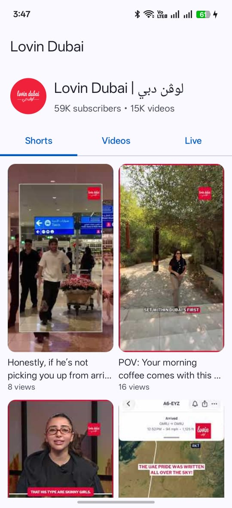
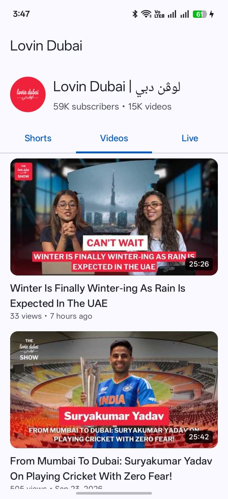
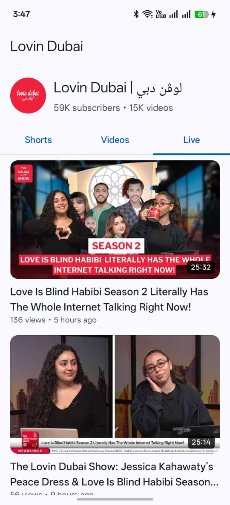
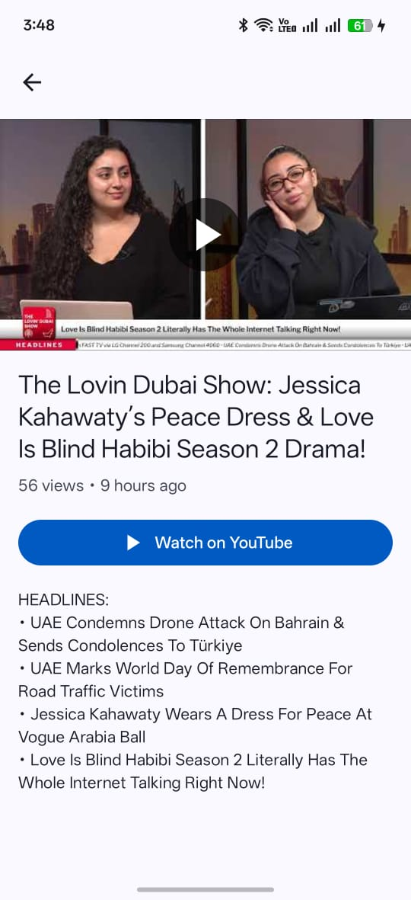
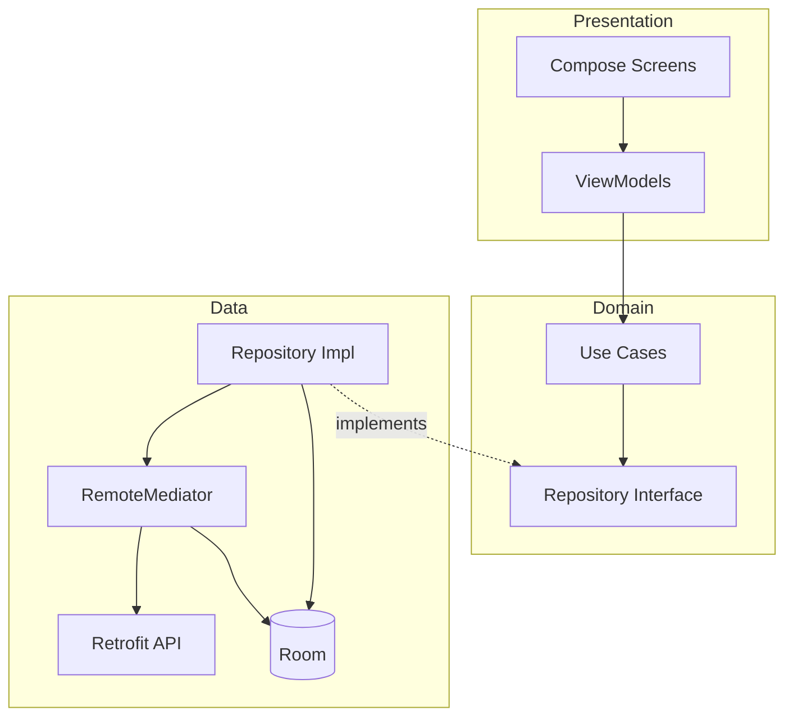

# Lovin Dubai

An Android app that shows content from the official [Lovin Dubai YouTube channel](https://www.youtube.com/@LovinDubai) using the YouTube Data API v3. Videos are split into **Shorts**, **Videos**, and **Live** streams, and the app works offline from a local cache.

| Shorts | Videos | Live | Details |
|---|---|---|---|
|  |  |  |  |

## Features

- Channel info and statistics
- Shorts, regular videos, and live streams (upcoming, live now, completed)
- Infinite scrolling, pull-to-refresh, and offline support
- Video details screen, with playback in the YouTube app
- Loading, empty, and error states
- Deleted and private videos are filtered out

## Tech Stack

Kotlin · Jetpack Compose · Material 3 · MVVM + Clean Architecture · Hilt · Retrofit · Coroutines & Flow · Room · Paging 3 · Coil · KSP

## Setup

1. Create an API key in the Google Cloud Console and enable **YouTube Data API v3**.
2. Add it to `local.properties`:
   ```properties
   YOUTUBE_API_KEY=your_api_key_here
   ```
3. Build and Run.

The key stays out of Git and is read from `BuildConfig` at build time.

## Architecture



Room is the **single source of truth**. The UI reads only from the database, and `RemoteMediator` fills it from the API when more data is needed. API endpoints, quota usage, and error handling are described in [API Integration](docs/API_INTEGRATION.md).

## Key Decisions

- **Quota optimization:** Use the uploads playlist instead of `search.list`. See [API Integration](docs/API_INTEGRATION.md).
- **Classification:** Assign video types when saving to Room.
- **Shorts detection:** Based on video duration (180s / 60s for older videos).
- **Live detection:** Use `liveBroadcastContent` and `liveStreamingDetails`.
- **Pagination:** Share one page token across all tabs.
- **Safe refresh:** Keep cached data until new data loads successfully.
- **Playback:** Open videos in the YouTube app.

## Testing

**Unit tests:** video classification (including the 180/181-second boundary), ISO 8601 parsing, and formatting.

**Instrumented tests:**
- `RemoteMediator` with an in-memory Room database and a fake API: deleted videos are skipped, a failed refresh keeps the cache, and a refresh uses exactly 3 API calls.
- Room tab queries: each tab returns only its own video type, sorted newest first.

```bash
./gradlew test                  # unit tests
./gradlew connectedAndroidTest  # instrumented tests (needs a device or emulator)
```

## Known Limitations

- A short horizontal video that is not a Short is classified as a Short, because the API does not expose the aspect ratio.
- Premieres return live stream details, so they appear in the Live tab.
- Upcoming streams that are not in the uploads playlist are not shown.
